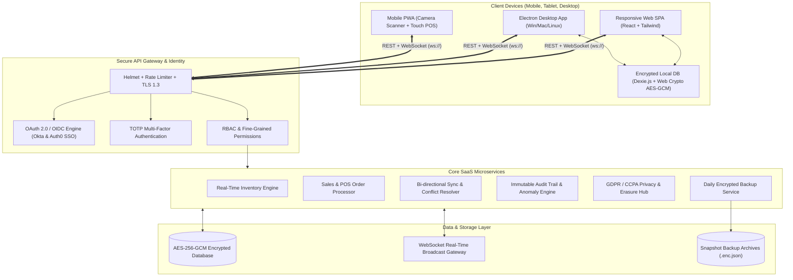

# 🛒 RetailPulse SaaS — Small Shop Management & Real-Time Intelligence

RetailPulse is an enterprise-grade, cloud-synchronized SaaS small shop management platform. It tracks real-time inventory and sales performance, features optical and hardware barcode scanning, generates automated daily financial reports, provides seamless offline-first capability with client-side encryption, and delivers comprehensive GDPR/CCPA compliance and security threat auditing.

---

## 🏛️ System Architecture



---

## 🚀 Key Features

| Capability | Specification |
| :--- | :--- |
| **Real-Time Inventory** | Stock tracking across multiple store locations, SKU & Barcode indexing, automatic low-stock notifications. |
| **Barcode Scanning** | Live optical camera scanner (HTML5 QR/Barcode) + instant hardware laser keyboard wedge support. |
| **Non-Technical Staff POS** | Single-screen cashier interface, touch-optimized product catalog, fast tender options, instant thermal receipts. |
| **Interactive Trends Dashboard** | Real-time charts for hourly sales velocity, 7-day revenue curve, gross profit margins, payment breakdowns. |
| **Daily Sales Financial Reports** | 1-click formatted PDF export with executive summaries and signature lines; custom CSV downloads. |
| **Offline Operating Mode** | Operates 100% offline during network outages using Dexie IndexedDB; auto-reconciles once reconnected. |
| **Data Encryption at Rest & In Transit** | AES-256-GCM authenticated encryption for database records and client-side Web Crypto AES-GCM for offline caches. |
| **Identity & OAuth 2.0 / OIDC** | Seamless enterprise SSO integration compatible with Okta and Auth0; OIDC discovery (`.well-known/openid-configuration`). |
| **Multi-Factor Authentication (MFA)** | Time-based One-Time Password (TOTP) with QR code setup, 6-digit verification, and emergency recovery codes. |
| **Role-Based Access Control (RBAC)** | Pre-configured roles: `super_admin`, `store_manager`, `cashier`, `compliance_auditor` with fine-grained permission flags. |
| **Security Auditing & Threat Detection** | Automated anomaly alerts for brute-force attacks, after-hours access, and high-value refunds with tunable thresholds. |
| **GDPR & CCPA Compliance Hub** | Right of Access (DSAR JSON export), Right to Erasure / Pseudonymization workflow, downloadable audit certificates. |
| **Automated Daily Backups** | 24-hour cron automated backup snapshots with SHA-256 integrity checksums and manual snapshot triggers. |
| **Cross-Platform Compatibility** | Mobile & Desktop responsive web, Docker containerized deployment, and Electron wrapper setup. |

---

## 👥 Preset Demo Accounts

Use these accounts to evaluate role-based permissions:

| Persona | Email | Password | Role | Permissions |
| :--- | :--- | :--- | :--- | :--- |
| **Super Admin** | `admin@retailpulse.io` | `Admin123!` | `super_admin` | Full system access, all stores, backups, security thresholds, GDPR erasure. |
| **Store Manager** | `manager@retailpulse.io` | `Manager123!` | `store_manager` | Inventory CRUD, replenishment POs, sales history, refund handling, local reports. |
| **Cashier Staff** | `cashier@retailpulse.io` | `Cashier123!` | `cashier` | POS checkout, barcode lookup, recording sales, receipt printing. |
| **Compliance Auditor** | `auditor@retailpulse.io` | `Auditor123!` | `compliance_auditor` | Read-only audit trail logs, threat monitoring, GDPR compliance certificates. |

---

## ⚡ Quick Start

### Prerequisites
- Node.js v18+ (Node v22+ recommended)
- npm v9+

### 1. Launch Backend Server
```bash
cd backend
npm install
npm start
```
*Backend runs at `http://localhost:4000` with WebSocket at `ws://localhost:4000/ws`.*
*For production, configure `PORT`, `NODE_ENV`, `JWT_SECRET`, `ENCRYPTION_MASTER_KEY`, `CORS_ORIGIN`, and `FRONTEND_URL` in the hosting provider. Production startup requires both secrets.*

### 2. Launch Frontend SPA
```bash
cd frontend
npm install
npm run dev
```
*Frontend opens at `http://localhost:5173`.*
*For a separately hosted production frontend, set `VITE_API_URL` (for example, `https://api.example.com/api`) and `VITE_WS_URL` (for example, `wss://api.example.com/ws`) before `npm run build`, then publish `dist`. These are build-time settings, not secrets.*

### 3. Launch Electron Desktop App
```bash
npm run electron:dev
```

### 4. Run with Docker Compose
```bash
docker-compose up -d --build
```
Compose reads its variables from the shell or a root `.env` file. Set at least:
```dotenv
JWT_SECRET=<long-random-secret>
ENCRYPTION_MASTER_KEY=<different-long-random-secret>
```
It defaults the browser-facing API and WebSocket URLs to `http://localhost:4000/api` and `ws://localhost:4000/ws`, and the allowed frontend origin to `http://localhost:5173`. Override these for custom domains/ports:
```dotenv
VITE_API_URL=https://api.example.com/api
VITE_WS_URL=wss://api.example.com/ws
CORS_ORIGIN=https://shop.example.com
FRONTEND_URL=https://shop.example.com
```
`VITE_API_URL` and `VITE_WS_URL` are passed as Docker build arguments, so rebuild the frontend image after changing them. `CORS_ORIGIN` may contain comma-separated origins. For standalone hosting, use the same variables in each service's environment; the backend loads `backend/.env` when run from that directory. Persist `backend/src/data` on the backend host because the JSON database, audit log, and backups are file-based.

---

## 📡 Sample Barcodes for Testing

When testing POS or Inventory Barcode Lookup, you can scan or enter:
- `890123456789` — Artisan Dark Roast Beans (12oz)
- `890123456790` — Ceremonial Matcha Green Tea Tin (50g) *(Low Stock Alert)*
- `890123456791` — Insulated Stainless Tumbler 16oz
- `890123456792` — Rustic Sourdough Boule (750g) *(Low Stock Alert)*
- `890123456793` — Organic Oat Milk Barista Edition (1L)
- `890123456795` — Wildflower Honeycomb Jar (16oz) *(Low Stock Alert)*

---

## 🛡️ GDPR & CCPA Compliance Endpoints

- `GET /api/compliance/summary` — Returns real-time regulatory compliance scorecard and technical safeguards.
- `POST /api/compliance/export-subject` — Generates complete machine-readable personal data export pursuant to GDPR Article 15.
- `POST /api/compliance/erasure` — Executes cryptographic pseudonymization and anonymization under GDPR Article 17.
